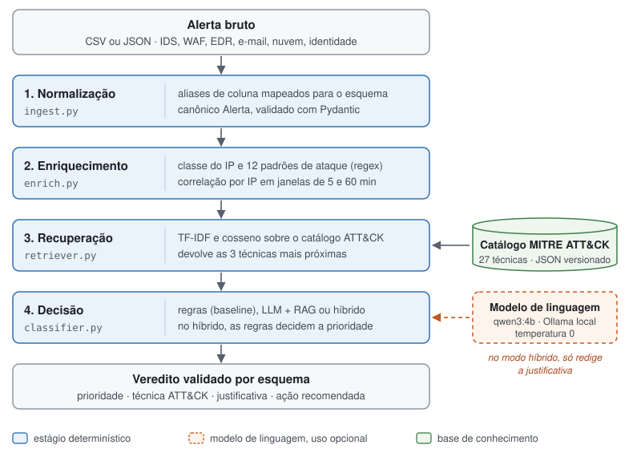

# Copiloto de SOC 4.0: triagem de alertas de segurança com RAG sobre MITRE ATT&CK

#### Aluno: [Leonardo Nunes Moreira do Valle](https://github.com/digitalopentech).
#### Orientador: [Leonardo Alfredo Forero Mendoza](https://github.com/leofome8).

---

Trabalho apresentado ao curso [Inteligência Artificial Generativa & Large Language Models](https://ica.ele.puc-rio.br/cursos/ia-generativa-large-language-models/) (2025.2) como pré-requisito para conclusão de curso e obtenção de crédito na disciplina "Projeto LLM".

- [Link para o código](https://github.com/digitalopentech/tcc-soc-copilot).

- Trabalhos relacionados:
    - [AiSOC — Open-source AI Security Operations Center](https://github.com/beenuar/AiSOC).
    - [AI_SOC — SOC aumentado por LLMs com orquestração multiagente](https://github.com/zhadyz/AI_SOC).
    - [LLMs for Log File Analysis — guia técnico da Splunk](https://www.splunk.com/en_us/blog/learn/log-file-analysis-llms.html).
    - [Analisador de Logs de Sistemas Computacionais Utilizando Redes Neurais e Sentence Transformer (PoC ICA/PUC-Rio)](https://github.com/secretaria-ICA/Analisador_de_Logs_de_Sistemas_Computacionais_Utilizando_Redes_Neurais_e_Sentence_Transformer).
    - [Identificação de Ataques de Força Bruta em SSH Utilizando Análise de Anomalias em Fluxos de Rede (PoC ICA/PUC-Rio)](https://github.com/secretaria-ICA/Identificacao_de_Ataques_de_Forca_Bruta_em_SSH_Utilizando_Analise_de_Anomalias_em_Fluxos_de_Rede).

---

### Resumo

Um Centro de Operações de Segurança (SOC) recebe milhares de alertas por dia de firewalls, IDS/IPS, EDR e SIEM. A maioria é falso positivo, mas cada alerta exige triagem — entender o que ocorreu, enriquecer com contexto e priorizar. O resultado é a *alert fatigue*: analistas saturados e alertas reais que passam despercebidos.

Este trabalho projeta, implementa e avalia um **copiloto de triagem de alertas** que recebe um alerta bruto, o enriquece de forma determinística, recupera contexto de ameaças da base **MITRE ATT&CK** por meio de RAG (*Retrieval-Augmented Generation*) e devolve uma classificação de prioridade acompanhada de justificativa rastreável e ação recomendada.

A contribuição central não é construir mais um copiloto — produtos comerciais já existem —, e sim **medir de forma independente e reproduzível** o que cada componente agrega. O sistema foi avaliado em dois conjuntos construídos para o trabalho — um *golden set* de desenvolvimento com 38 alertas e um **benchmark aberto de 240 alertas** cobrindo seis fontes de telemetria (IDS, WAF, EDR, gateway de e-mail, nuvem e identidade), com 20% de casos deliberadamente ambíguos — por meio de experimentos de ablação que comparam três configurações: (i) um classificador determinístico baseado em regras explícitas sobre features extraídas do alerta; (ii) o mesmo pipeline acrescido de recuperação de contexto ATT&CK; e (iii) classificação por um modelo de linguagem (`qwen3:4b`, executado localmente). Uma quarta configuração, híbrida, mantém a decisão nas regras e usa o modelo apenas para redigir a justificativa.

Os resultados contrariam a expectativa inicial e constituem a principal contribuição empírica do trabalho. No golden set, o baseline determinístico alcançou **F1-macro de 0,968 com custo de erro zero**, enquanto a configuração com modelo de linguagem obteve **F1-macro de 0,349**, classificando incorretamente como falso positivo 2 dos 12 alertas de prioridade máxima — o modo de falha mais grave em operações de segurança. No benchmark de 240 alertas o quadro se mantém: **F1-macro de 0,707 para o baseline contra 0,333 para o modelo**, que descartou como falso positivo 16 dos 60 alertas de prioridade máxima (o baseline, 8). A recuperação de contexto, por sua vez, demonstrou valor em uma dimensão distinta da priorização: elevou o acerto na identificação da técnica ATT&CK de 0,680 para 0,800 no golden set e de 0,106 para 0,381 no benchmark.

Conclui-se que, para triagem de alertas estruturados, a arquitetura adequada é **híbrida**: o componente determinístico decide a prioridade, enquanto o modelo de linguagem enriquece, contextualiza e redige a justificativa destinada ao analista. A validação externa em UNSW-NB15 e CIC-IDS2017 revelou ainda que os benchmarks públicos de detecção de intrusão não contêm o dado textual que um modelo de linguagem precisa ler — lacuna que motivou a construção do benchmark aberto aqui proposto. Todo o material é reprodutível sem GPU ou serviços de nuvem.

**Palavras-chave:** centro de operações de segurança; triagem de alertas; geração aumentada por recuperação; MITRE ATT&CK; modelos de linguagem.

### Abstract

A Security Operations Center (SOC) receives thousands of alerts per day from firewalls, IDS/IPS, EDR and SIEM systems. Most are false positives, yet each alert requires triage — understanding what happened, enriching it with context, and prioritizing it. The outcome is alert fatigue: saturated analysts and genuine alerts slipping through.

This work designs, implements and evaluates an **alert triage copilot** that takes a raw alert, enriches it deterministically, retrieves threat context from the **MITRE ATT&CK** knowledge base through Retrieval-Augmented Generation (RAG), and returns a priority classification with traceable justification and a recommended action.

The core contribution is not building yet another copilot — commercial products already exist — but **independently and reproducibly measuring** what each component adds. The system was evaluated on two datasets built for this work — a 38-alert development golden set and an **open benchmark of 240 alerts** spanning six telemetry sources (IDS, WAF, EDR, e-mail gateway, cloud and identity), 20% of them deliberately ambiguous — through ablation experiments comparing three configurations: (i) a deterministic rule-based classifier over features extracted from the alert; (ii) the same pipeline augmented with ATT&CK context retrieval; and (iii) classification by a language model (`qwen3:4b`, running locally). A fourth, hybrid configuration keeps the decision in the rules and uses the model only to draft the justification.

The results contradict the initial expectation and constitute the main empirical contribution of this work. On the golden set, the deterministic baseline achieved a **macro-F1 of 0.968 with zero error cost**, whereas the language-model configuration reached a **macro-F1 of 0.349**, misclassifying 2 out of 12 highest-priority alerts as false positives — the most severe failure mode in security operations. On the 240-alert benchmark the picture holds: **macro-F1 of 0.707 for the baseline against 0.333 for the model**, which dismissed 16 of the 60 highest-priority alerts as false positives (the baseline, 8). Context retrieval, in turn, proved valuable along a dimension distinct from prioritization: it raised ATT&CK technique identification accuracy from 0.680 to 0.800 on the golden set and from 0.106 to 0.381 on the benchmark.

We conclude that, for structured alert triage, the appropriate architecture is **hybrid**: the deterministic component decides priority, while the language model enriches, contextualizes and drafts the justification for the analyst. External validation on UNSW-NB15 and CIC-IDS2017 further revealed that public intrusion-detection benchmarks do not carry the textual data a language model needs to read — a gap that motivated the open benchmark proposed here. All material is reproducible without GPU or cloud services.

**Keywords:** security operations center; alert triage; retrieval-augmented generation; MITRE ATT&CK; language models.

---

### 1. Introdução

#### 1.1 Contexto e motivação

Um Centro de Operações de Segurança (SOC, do inglês *Security Operations Center*) concentra o monitoramento e a resposta a incidentes de uma organização. As ferramentas de detecção — IDS/IPS, WAF, EDR, gateways de e-mail e SIEM — produzem milhares de alertas por dia, e cada um precisa ser triado por um analista: entender o que ocorreu, reunir contexto e decidir a prioridade. A maior parte desses alertas não corresponde a incidentes. Em estudo com profissionais de sete SOCs, Alahmadi, Axon e Martinovic (2022) observaram que a maioria dos falsos positivos decorre de gatilhos benignos, isto é, alarmes tecnicamente corretos explicados por comportamento legítimo do ambiente. O volume e a repetição levam à fadiga de alertas (*alert fatigue*): o analista saturado deixa de investigar parte do que recebe, e ataques reais se perdem no ruído (HASSAN et al., 2019).

Este trabalho usa o termo **SOC 4.0**, por analogia à Indústria 4.0, para designar a geração de centros de operações em que automação e inteligência artificial generativa assumem parte da triagem e da investigação, com o analista humano mantido na decisão final. Modelos de linguagem de grande porte (LLMs) e a geração aumentada por recuperação (RAG), que combina o modelo a uma base de conhecimento consultada no momento da inferência (LEWIS et al., 2020), tornaram plausível automatizar parte desse trabalho: ler o alerta, associá-lo a uma técnica de ataque e redigir uma justificativa para o analista. Aqui, a base de conhecimento é o MITRE ATT&CK, taxonomia pública de táticas e técnicas adversárias observadas em ataques reais (STROM et al., 2020).

#### 1.2 Pergunta de pesquisa e objetivos

A pergunta que orienta o trabalho é: **um copiloto com RAG sobre o MITRE ATT&CK faz a triagem de alertas com qualidade utilizável, e quanto cada componente — enriquecimento determinístico, recuperação de contexto e modelo de linguagem — contribui para o resultado?**

O **objetivo geral** é projetar, implementar e avaliar de forma reprodutível um copiloto de triagem que recebe um alerta bruto e devolve prioridade, técnica ATT&CK, justificativa e ação recomendada. Os **objetivos específicos** são:

1. implementar o pipeline em quatro estágios: normalização, enriquecimento, recuperação e decisão;
2. construir conjuntos de avaliação rotulados que contenham o texto do alerta;
3. medir, por ablação, a contribuição de cada componente, com um classificador determinístico como grupo de controle;
4. verificar a generalização em conjuntos públicos de detecção de intrusão.

A proposta inicial previa também um braço de implantação em nuvem, ajuste fino (*fine-tuning*) e uma arquitetura multiagente. Esses itens foram deslocados para trabalhos futuros (seção 4.2), para concentrar o esforço na qualidade da avaliação.

#### 1.3 Trabalhos relacionados

O copiloto de SOC já é uma categoria comercial. Microsoft Security Copilot, CrowdStrike Charlotte AI e SentinelOne Purple AI integram modelos de linguagem às respectivas plataformas. Freitas et al. (2024) descrevem o sistema de resposta guiada da Microsoft e publicam o GUIDE, o maior conjunto público de incidentes com rótulo de triagem atribuído por analistas. Entre os projetos de código aberto, o AiSOC e o AI_SOC combinam triagem por agentes, RAG e modelos executados localmente; o segundo usa o Foundation-Sec-8B, modelo especializado em segurança (KASSIANIK et al., 2025). Na prática de observabilidade, a Splunk (2025) recomenda uma arquitetura híbrida, em que o pipeline tradicional filtra e agrega os eventos e o modelo é acionado apenas onde há raciocínio contextual a fazer. No próprio ICA/PUC-Rio, trabalhos anteriores trataram problemas vizinhos com aprendizado de máquina: análise de logs com redes neurais e *Sentence Transformers* e detecção de força bruta em SSH por anomalias em fluxos de rede.

Dois pontos permanecem em aberto. Primeiro, os produtos comerciais não publicam avaliação independente, e os projetos abertos demonstram viabilidade sem medir o que cada componente agrega. Segundo, os benchmarks públicos da área não trazem o texto do alerta: UNSW-NB15 (MOUSTAFA; SLAY, 2015) e CIC-IDS2017 (SHARAFALDIN; LASHKARI; GHORBANI, 2018) são distribuídos como atributos estatísticos de fluxo, e no GUIDE os campos textuais foram substituídos por identificadores numéricos anonimizados. Sem o texto, não há como avaliar o que um modelo de linguagem efetivamente lê.

#### 1.4 Contribuições

1. Um pipeline de triagem reprodutível, executável sem GPU, sem credenciais e sem serviços de nuvem.
2. Um protocolo de avaliação por ablação com baseline determinístico obrigatório e uma métrica de custo assimétrico do erro.
3. Um benchmark aberto de 240 alertas textuais, de seis fontes de telemetria, com 20% de casos ambíguos e justificativa documentada para cada rótulo ambíguo.
4. Evidência empírica de que, na priorização, um modelo de linguagem pequeno perde para regras explícitas, e de que o valor do RAG está na identificação da técnica de ataque.

### 2. Metodologia

#### 2.1 Arquitetura do copiloto

O copiloto atua **depois da detecção**: recebe o alerta que IDS, WAF, EDR ou SIEM já produziram e devolve um veredito estruturado. O projeto segue um princípio: **tudo que precisa ser exato é código determinístico, e o modelo de linguagem atua apenas onde o raciocínio contextual agrega valor.** A separação responde a limitações conhecidas do uso de LLMs em análise de logs, como a correlação temporal pouco confiável, o custo em volume e a variação de resposta entre execuções (SPLUNK, 2025). A Figura 1 apresenta a arquitetura e a Tabela 1 detalha cada estágio.

**Figura 1** – Arquitetura do copiloto de triagem.



*Fonte: elaborado pelo autor.*

**Tabela 1** – Estágios do pipeline de triagem.

| Estágio | O que faz | Módulo |
|---|---|---|
| 1. Normalização | Mapeia colunas heterogêneas (CSV/JSON) para o esquema canônico `Alerta`, validado com Pydantic; linhas malformadas são descartadas com aviso | `ingest.py` |
| 2. Enriquecimento | Classe do IP (privado ou público), 12 padrões de ataque por expressão regular e correlação temporal de eventos do mesmo IP em janelas de 5 e 60 minutos | `enrich.py` |
| 3. Recuperação (RAG) | Busca as três técnicas MITRE ATT&CK mais próximas do alerta no catálogo versionado de 27 técnicas | `retriever.py` |
| 4. Decisão | Regras determinísticas (baseline), modelo de linguagem, ou híbrido: as regras decidem a prioridade e o modelo redige a justificativa | `classifier.py` |

*Fonte: elaborado pelo autor.*

A **recuperação** usa TF-IDF (SALTON; BUCKLEY, 1988) com similaridade de cosseno, implementados com scikit-learn (PEDREGOSA et al., 2011). A escolha por recuperação esparsa, e não por *embeddings* densos, privilegia a reprodutibilidade: o recuperador roda offline, sem download de modelo e sem GPU.

O **classificador por regras** aplica heurísticas explícitas em ordem de precedência. Primeiro, o contexto de atividade sancionada (varredura agendada, backup, *pentest* autorizado) marca o alerta como falso positivo, pois um *pentest* carrega *payload* real de ataque e só o contexto o distingue de um incidente. Em seguida, a severidade declarada pela ferramenta de origem é combinada ao padrão de ataque confirmado. Por fim, padrões, classe do IP e volume de eventos correlacionados definem os casos restantes; por exemplo, força bruta com dez ou mais tentativas na última hora é prioridade ALTA.

O **classificador com modelo de linguagem** usa o `qwen3:4b` (YANG et al., 2025), executado localmente pelo Ollama com temperatura 0 e saída em JSON. O modelo recebe o alerta, o enriquecimento e as técnicas recuperadas. A resposta é validada por um esquema Pydantic; se for inválida, há uma nova tentativa e, persistindo a falha, o sistema recorre às regras. Como o *payload* de um alerta é conteúdo controlado pelo adversário, o alerta entra no prompt delimitado como dado, nunca como instrução, para mitigar injeção de prompt, o primeiro risco da lista da OWASP para aplicações com LLMs (OWASP FOUNDATION, 2024).

No **modo híbrido**, prioridade e técnica vêm das regras com recuperação, e o modelo redige apenas a justificativa e a ação recomendada. Um teste automatizado garante que uma resposta do modelo tentando rebaixar a prioridade é descartada. Em todos os modos, o veredito registra o caminho que o produziu, requisito de auditabilidade em operações de segurança.

#### 2.2 Conjuntos de dados

A Tabela 2 resume os quatro conjuntos usados. Os dois primeiros foram construídos para o trabalho porque contêm o que os públicos não têm: descrição, *payload* e endereçamento do alerta.

**Tabela 2** – Conjuntos de dados da avaliação.

| Conjunto | Natureza | n | Composição | Papel |
|---|---|---|---|---|
| Golden set | Sintético, construído manualmente | 38 | ALTA 12, MÉDIA 10, BAIXA 7, falso positivo 9; inclui casos-limite deliberados, como *pentest* autorizado com *payload* real | Desenvolvimento |
| Benchmark v1 | Sintético, gerado por script reprodutível | 240 | Seis fontes com 40 alertas cada: IDS/IPS, WAF, EDR, gateway de e-mail, nuvem e identidade; 49 casos ambíguos (20,4%) com justificativa de rótulo | Avaliação principal |
| UNSW-NB15 | Real, atributos de fluxo (MOUSTAFA; SLAY, 2015) | 250 | Amostra estratificada, 25 fluxos por categoria | Validação externa |
| CIC-IDS2017 | Real, atributos de fluxo (SHARAFALDIN; LASHKARI; GHORBANI, 2018) | 141 | Subconjunto WebAttacks: SQL injection e XSS, força bruta e tráfego benigno | Validação externa |

*Fonte: elaborado pelo autor.*

Nos conjuntos públicos, cada categoria de ataque foi mapeada para uma prioridade conforme o impacto operacional; no UNSW-NB15, por exemplo, *Exploits*, *Backdoor*, *Shellcode* e *Worms* correspondem a ALTA. A primeira versão do adaptador do UNSW-NB15 derivava a severidade da própria categoria de ataque, o que embutia o rótulo na entrada e produzia uma acurácia artificial de 0,900. O vazamento foi corrigido: a severidade passou a ser estimada apenas a partir de atributos do fluxo, como faria uma ferramenta real, e os números reportados referem-se à versão corrigida.

#### 2.3 Protocolo experimental

O desenho é uma **ablação incremental**: cada configuração acrescenta um componente à anterior, de modo que a diferença observada seja atribuível a esse componente (Tabela 3). Todas as configurações processam os mesmos alertas, na mesma ordem, com o mesmo enriquecimento.

**Tabela 3** – Configurações comparadas na ablação.

| # | Configuração | Quem decide a prioridade | Origem da técnica ATT&CK |
|---|---|---|---|
| 1 | Baseline | Regras | Associação fixa entre padrão e técnica |
| 2 | Regras + RAG | Regras | Recuperação TF-IDF quando a regra não fixa a técnica |
| 3 | LLM + RAG | Modelo de linguagem | Modelo, a partir das três técnicas recuperadas |
| 4 | Híbrido | Regras | Como na configuração 2; o modelo só redige a justificativa |

*Fonte: elaborado pelo autor.*

Os experimentos rodaram em um Apple M3 com 16 GB de memória, sem GPU dedicada. As configurações determinísticas executam em milissegundos por alerta; cada chamada ao modelo levou entre 17 e 40 segundos nas execuções registradas.

#### 2.4 Métricas

- **Acurácia**: fração de alertas com prioridade correta.
- **F1-macro**: média simples do F1 das quatro classes de prioridade, de modo que classes menores pesam o mesmo que as maiores.
- **Custo de erro**: soma ponderada dos erros que subestimam a gravidade, com pesos 10 para ALTA classificada como falso positivo, 5 para ALTA classificada como BAIXA e 3 para MÉDIA classificada como falso positivo. Superestimar não é penalizado, pois gera trabalho adicional ao analista, mas não deixa um incidente sem investigação.
- **Acerto de técnica**: fração dos alertas com técnica ATT&CK rotulada em que a técnica atribuída coincide com o rótulo; são 25 alertas no golden set e 160 no benchmark.

#### 2.5 Exemplo de funcionamento

O Quadro 1 mostra a saída real do modo de demonstração para dois alertas do golden set, com o que entra e o que sai em cada estágio.

**Quadro 1** – Triagem passo a passo de dois alertas do golden set.

```text
[ALT-0001]  rótulo real: ALTA
  1. alerta        : IDS · 2026-03-15 08:00 · 203.0.113.10 → 10.0.1.5:443/TCP · severidade da fonte: high
     descrição     : SQL injection em formulario de login
     payload       : ' OR 1=1--
  2. enriquecimento: ip_origem=publico · padrões=sqli · eventos do mesmo IP em 60 min: 1
  3. recuperação   : T1190 Exploit Public-Facing Application (0.25) · T1598 Phishing for Information (0.17) · T1055 Process Injection (0.14)
  4. veredito      : ALTA ✔  (confiança 0.88 · modo regras)
     técnica       : T1190
     justificativa : fonte classificou como 'high' e o payload confirma o padrao 'sqli' — indicio consistente de ataque em andamento.
     ação          : Escalar imediatamente para o analista de plantão e isolar o host de origem/destino conforme runbook.

[ALT-0030]  rótulo real: FALSO_POSITIVO
  1. alerta        : Scanner · 2026-03-15 10:00 · 10.0.4.10 → 10.0.1.5:443/TCP · severidade da fonte: medium
     descrição     : Scanner de vulnerabilidade agendado
     payload       : Nessus scan janela aprovada
  2. enriquecimento: ip_origem=privado · padrões=nenhum · eventos do mesmo IP em 60 min: 1
  3. recuperação   : T1046 Network Service Discovery (0.38) · T1098 Account Manipulation (0.13) · T1486 Data Encrypted for Impact (0.12)
  4. veredito      : FALSO_POSITIVO ✔  (confiança 0.80 · modo regras)
     técnica       : T1046
     justificativa : atividade compativel com operacao sancionada ou ruido conhecido (scanner agendado, backup, health check, pentest autorizado).
     ação          : Arquivar; opcionalmente ajustar regra de detecção de origem para reduzir ruído.
```

*Fonte: saída do comando `make demo`, executado pelo autor.*

### 3. Resultados e discussão

#### 3.1 Ablação no golden set

**Tabela 4** – Resultados da ablação no golden set (38 alertas).

| Configuração | Acurácia | F1-macro | Custo de erro | Acerto de técnica |
|---|---|---|---|---|
| Baseline (regras determinísticas) | 0,974 | 0,968 | **0** | 0,680 |
| Regras + RAG | 0,974 | 0,968 | **0** | **0,800** |
| LLM (`qwen3:4b`) + RAG | 0,500 | 0,349 | 50 | 0,600 |
| **Híbrido (regras decidem, LLM redige)** | **0,974** | **0,968** | **0** | **0,800** |

*Fonte: elaborado pelo autor, a partir de `resultados/ablacao.json`.*

O baseline erra um único alerta, uma prioridade BAIXA classificada como falso positivo, erro que não entra no custo ponderado. A recuperação de contexto não altera nenhuma métrica de prioridade, mas eleva o acerto de técnica de 0,680 para 0,800. O modelo de linguagem não usou as classes BAIXA e MÉDIA em nenhuma das 38 decisões: classificou 28 alertas como falso positivo e 10 como ALTA. Com isso, acerta todos os falsos positivos verdadeiros, porque classifica quase tudo assim, e descarta 2 dos 12 alertas de prioridade ALTA.

#### 3.2 Ablação no benchmark aberto

**Tabela 5** – Resultados da ablação no benchmark aberto (240 alertas, seis fontes, 20% ambíguos).

| Configuração | Acurácia | F1-macro | Custo de erro | Acerto de técnica |
|---|---|---|---|---|
| Baseline (regras determinísticas) | 0,733 | 0,707 | 89 | 0,106 |
| Regras + RAG | 0,733 | 0,707 | 89 | 0,381 |
| LLM (`qwen3:4b`) + RAG | 0,438 | 0,333 | 367 | **0,469** |
| **Híbrido (regras decidem, LLM redige)** | **0,733** | **0,707** | **89** | 0,381 |

*Fonte: elaborado pelo autor, a partir de `resultados/benchmark_v1.json`.*

O benchmark discrimina onde o golden set saturava. O baseline deixa de ser perfeito, e as matrizes de confusão das Tabelas 6 e 7 mostram onde cada abordagem erra.

**Tabela 6** – Matriz de confusão das regras no benchmark (linhas: rótulo real; colunas: predição).

| Real \ Predito | Falso positivo | BAIXA | MÉDIA | ALTA |
|---|---|---|---|---|
| Falso positivo | 17 | 37 | 5 | 1 |
| BAIXA | 2 | 46 | 0 | 0 |
| MÉDIA | 3 | 3 | 66 | 0 |
| ALTA | **8** | 0 | 5 | 47 |

*Fonte: elaborado pelo autor.*

**Tabela 7** – Matriz de confusão do modelo de linguagem no benchmark (linhas: rótulo real; colunas: predição).

| Real \ Predito | Falso positivo | BAIXA | MÉDIA | ALTA |
|---|---|---|---|---|
| Falso positivo | 60 | 0 | 0 | 0 |
| BAIXA | 48 | 0 | 0 | 0 |
| MÉDIA | 69 | 0 | 1 | 2 |
| ALTA | **16** | 0 | 0 | 44 |

*Fonte: elaborado pelo autor.*

As regras descartam 8 dos 60 alertas ALTA como falso positivo, o erro caro, e escalam 37 dos 60 falsos positivos para BAIXA, o erro barato que o custo ponderado ignora de propósito. O modelo repete o padrão do golden set: colapsa a decisão em falso positivo e ALTA, nunca usa BAIXA, usa MÉDIA uma vez em 72 e descarta 16 dos 60 alertas ALTA, o dobro das regras, com custo de erro quatro vezes maior. Na identificação da técnica, porém, o modelo supera a recuperação esparsa neste conjunto (0,469 contra 0,381); no golden set, menor e com *payloads* mais diretos, ocorre o inverso (0,600 contra 0,800).

#### 3.3 Validação externa em conjuntos públicos

**Tabela 8** – Desempenho do pipeline (regras + RAG) nos quatro conjuntos.

| Conjunto | Natureza | n | F1-macro | Custo de erro |
|---|---|---|---|---|
| Golden set | Sintético, com *payload* e IP | 38 | 0,968 | 0 |
| Benchmark v1 | Sintético, com *payload* e IP, 20% ambíguo | 240 | 0,707 | 89 |
| UNSW-NB15 | Real, atributos de fluxo | 250 | 0,104 | 495 |
| CIC-IDS2017 (WebAttacks) | Real, atributos de fluxo | 141 | 0,000 | 305 |

*Fonte: elaborado pelo autor, a partir dos arquivos em `resultados/`.*

O contraste é o segundo achado do trabalho. No UNSW-NB15, 99 dos 100 alertas ALTA foram classificados como BAIXA; no CIC-IDS2017, nenhuma das 141 predições foi correta, inclusive nos ataques web para os quais as regras foram escritas. A causa é estrutural: os dois conjuntos são distribuídos sem *payload*, sem endereço IP e sem URL, apenas com estatísticas de fluxo. Sem texto para inspecionar, as regras recaem na severidade estimada do fluxo, que é baixa para quase tudo. O pipeline resolve a triagem de **alertas textuais** e não resolve a classificação de **fluxos de rede**, duas tarefas que a literatura frequentemente agrupa sob o mesmo rótulo de detecção de intrusão. Para fluxos, a abordagem adequada continua sendo o aprendizado supervisionado sobre atributos numéricos.

#### 3.4 Discussão

**O modelo pequeno é sistematicamente otimista.** Nos dois conjuntos, o `qwen3:4b` subestima a gravidade e concentra as decisões em falso positivo. Em um SOC, esse é o viés mais perigoso possível, porque transforma incidentes em ruído arquivado.

**A força das regras depende do domínio.** As regras vencem quando o alerta traz *payload* textual, endereçamento e a severidade atribuída pela ferramenta de origem, sinal legítimo e sempre disponível em um SIEM. Fora desse domínio, como mostram os conjuntos de fluxo, elas colapsam. A afirmação correta não é "regras superam modelos de linguagem", e sim "regras superam um modelo pequeno quando os alertas contêm texto e contexto estruturado".

**Priorizar e identificar a técnica são problemas distintos.** Priorizar depende de sinais estruturados; identificar a técnica depende de correspondência semântica entre a descrição do evento e a da técnica. A recuperação melhora a segunda tarefa sem tocar na primeira, e trabalhos que reportam uma única métrica agregada não conseguem separar esses efeitos. A recuperação esparsa também se mostrou sensível ao tamanho do catálogo: com 10 técnicas, o acerto no golden set era de 0,880; com 27, caiu para 0,800.

**Custo e latência reforçam o uso seletivo do modelo.** Com regras em milissegundos e o modelo em dezenas de segundos por alerta, submeter todo o volume diário de um SOC ao modelo é inviável em hardware local. A arquitetura híbrida preserva integralmente a qualidade da decisão determinística e acrescenta o que o modelo faz bem: redigir uma justificativa legível. Um exemplo de saída real do modo híbrido: *"O alerta foi classificado como FALSO_POSITIVO porque a transferência de 2GB para storage interno em rede privada (10.0.2.50 → 10.0.4.20) é um padrão compatível com rotina de backup automático."*

### 4. Conclusões

A resposta à pergunta de pesquisa é afirmativa para a triagem de alertas textuais, desde que o modelo de linguagem não decida a prioridade. O principal resultado do trabalho é que, na priorização, regras explícitas sobre atributos bem escolhidos superaram o modelo de linguagem nos dois conjuntos com texto, com F1-macro de 0,968 contra 0,349 no golden set e de 0,707 contra 0,333 no benchmark, e que o modelo errou justamente na direção mais cara, descartando alertas de prioridade máxima. A recuperação de contexto tem valor comprovado, mas na identificação da técnica ATT&CK, não na decisão. A arquitetura recomendada é, portanto, híbrida: o componente determinístico decide e o modelo enriquece, contextualiza e redige.

O segundo resultado é metodológico. Os benchmarks públicos de detecção de intrusão não contêm o texto do alerta, e por isso não permitem avaliar de forma reproduzível o que um modelo de linguagem acrescenta à triagem. O benchmark aberto de 240 alertas proposto aqui é uma contribuição direta para preencher essa lacuna.

#### 4.1 Limitações

- **Tamanho e natureza dos dados.** O golden set tem 38 alertas e o benchmark é sintético; os resultados são indicativos, não conclusivos, e não substituem avaliação com dados de produção.
- **Autoria única dos rótulos.** Os casos e rótulos foram escritos pelo autor, sem medida de concordância entre anotadores. A justificativa de cada rótulo ambíguo torna a decisão auditável, mas não a valida.
- **Origem comum de regras e dados.** As regras foram refinadas observando o golden set, e regras e benchmark cobrem padrões de ataque semelhantes, ainda que as regras não tenham sido alteradas após a geração do benchmark.
- **Um único modelo e um único prompt.** O `qwen3:4b` é pequeno e generalista, e não houve exploração sistemática de prompts ou exemplos (*few-shot*). As conclusões não se estendem a modelos maiores ou especializados em segurança.
- **Catálogo e enriquecimento restritos.** O catálogo cobre 27 técnicas, e o enriquecimento não consulta fontes externas, como reputação de IP ou bases de vulnerabilidades.

#### 4.2 Trabalhos futuros

- Repetir a avaliação com modelos maiores e com modelos especializados em segurança, como o Foundation-Sec-8B (KASSIANIK et al., 2025).
- Delegar ao modelo a identificação da técnica no modo híbrido, mantendo a prioridade nas regras, já que o modelo superou a recuperação esparsa nessa tarefa no benchmark.
- Ampliar o benchmark com casos escritos e rotulados por terceiros, com medida de concordância entre anotadores.
- Avaliar ajuste fino para corrigir o viés otimista, que é sistemático e, portanto, candidato natural a correção supervisionada.
- Retomar os itens da proposta inicial: implantação em nuvem com comparação de custo local e em nuvem, arquitetura multiagente e ingestão contínua de alertas.
- Acrescentar um classificador supervisionado dedicado a alertas de fluxo de rede, o caminho que as regras textuais não cobrem.

### Referências

ALAHMADI, B. A.; AXON, L.; MARTINOVIC, I. 99% false positives: a qualitative study of SOC analysts' perspectives on security alarms. In: USENIX SECURITY SYMPOSIUM, 31., 2022, Boston. **Proceedings** [...]. Berkeley: USENIX Association, 2022. p. 2783-2800.

FREITAS, S. et al. AI-driven guided response for security operation centers with Microsoft Copilot for Security. **arXiv preprint**, arXiv:2407.09017, 2024.

HASSAN, W. U. et al. NoDoze: combatting threat alert fatigue with automated provenance triage. In: NETWORK AND DISTRIBUTED SYSTEM SECURITY SYMPOSIUM, 2019, San Diego. **Proceedings** [...]. Reston: Internet Society, 2019.

KASSIANIK, P. et al. Llama-3.1-FoundationAI-SecurityLLM-Base-8B technical report. **arXiv preprint**, arXiv:2504.21039, 2025.

LEWIS, P. et al. Retrieval-augmented generation for knowledge-intensive NLP tasks. In: CONFERENCE ON NEURAL INFORMATION PROCESSING SYSTEMS, 34., 2020. **Advances in Neural Information Processing Systems 33**. Red Hook: Curran Associates, 2020. p. 9459-9474.

MOUSTAFA, N.; SLAY, J. UNSW-NB15: a comprehensive data set for network intrusion detection systems (UNSW-NB15 network data set). In: MILITARY COMMUNICATIONS AND INFORMATION SYSTEMS CONFERENCE, 2015, Canberra. **Proceedings** [...]. Piscataway: IEEE, 2015. p. 1-6.

OWASP FOUNDATION. **OWASP Top 10 for LLM Applications 2025**. [S. l.]: OWASP Foundation, 2024. Disponível em: https://genai.owasp.org/llm-top-10/. Acesso em: 13 nov. 2026.

PEDREGOSA, F. et al. Scikit-learn: machine learning in Python. **Journal of Machine Learning Research**, v. 12, p. 2825-2830, 2011.

SALTON, G.; BUCKLEY, C. Term-weighting approaches in automatic text retrieval. **Information Processing & Management**, v. 24, n. 5, p. 513-523, 1988.

SHARAFALDIN, I.; LASHKARI, A. H.; GHORBANI, A. A. Toward generating a new intrusion detection dataset and intrusion traffic characterization. In: INTERNATIONAL CONFERENCE ON INFORMATION SYSTEMS SECURITY AND PRIVACY, 4., 2018, Funchal. **Proceedings** [...]. Setúbal: SciTePress, 2018. p. 108-116.

SPLUNK. **LLMs for log file analysis**. [S. l.]: Splunk, 2025. Disponível em: https://www.splunk.com/en_us/blog/learn/log-file-analysis-llms.html. Acesso em: 13 nov. 2026.

STROM, B. E. et al. **MITRE ATT&CK: design and philosophy**. McLean: The MITRE Corporation, 2020. Technical Report MP180360R1.

YANG, A. et al. Qwen3 technical report. **arXiv preprint**, arXiv:2505.09388, 2025.

### Apêndice A – Reprodução dos experimentos

#### A.1 Execução determinística

Requisitos: Python 3.10 ou superior, ou Docker. O caminho determinístico não precisa de GPU, credenciais nem serviços externos, e reproduz todos os números das configurações 1, 2 e 4.

```bash
git clone https://github.com/digitalopentech/tcc-soc-copilot.git
cd tcc-soc-copilot
make setup       # cria .venv e instala as dependências
make demo        # triagem passo a passo de um alerta por classe
make eval        # ablação no golden set (38 alertas)
make benchmark   # ablação no benchmark aberto (240 alertas)
make test        # suíte de testes
```

Sem `make`, os mesmos comandos:

```bash
python3 -m venv .venv && source .venv/bin/activate   # Windows: .venv\Scripts\activate
pip install -r requirements.txt
PYTHONPATH=src python -m soc_copilot.cli --demo
PYTHONPATH=src python -m soc_copilot.cli
PYTHONPATH=src python -m soc_copilot.cli --golden data/benchmark_v1.csv
pytest -q
```

Com Docker (ambiente isolado, idêntico ao usado nos experimentos):

```bash
docker build -t soc-copilot .
docker run --rm soc-copilot                                    # ablação determinística
docker run --rm soc-copilot python -m soc_copilot.cli --demo   # demonstração
docker run --rm soc-copilot pytest -q                          # testes
```

#### A.2 Configurações com modelo de linguagem

Exigem o [Ollama](https://ollama.com) em execução com o modelo `qwen3:4b` (`ollama pull qwen3:4b`). Cada chamada ao modelo leva de 17 s a 40 s, conforme o hardware. A opção `--saida` grava as métricas no formato JSON usado em `resultados/`:

```bash
make llm                                                # golden set → resultados/ablacao.json
PYTHONPATH=src python -m soc_copilot.cli --llm --golden data/benchmark_v1.csv --saida resultados/benchmark_v1.json
PYTHONPATH=src python -m soc_copilot.cli --llm --demo   # demonstração em modo híbrido
```

#### A.3 Organização do repositório

```
├── README.md            # este documento (padrão ICA-cursos/PoCs)
├── Makefile             # atalhos: make setup | demo | eval | benchmark | llm | test | docker
├── Dockerfile           # ambiente reprodutível
├── requirements.txt     # dependências mínimas (pydantic, pandas, scikit-learn, numpy, pytest)
├── src/soc_copilot/     # pipeline: ingestão → enriquecimento → RAG → classificação · CLI
├── data/                # catálogo MITRE ATT&CK, golden set e benchmark_v1 rotulados
├── scripts/             # gerador reprodutível do benchmark (casos por fonte de telemetria)
├── resultados/          # métricas das ablações e validações externas (JSON)
├── tests/               # suíte pytest
├── docs/                # tese, arquitetura, resultados, proposta, estrutura da monografia e figuras
└── LICENSE              # MIT
```

#### A.4 Documentação complementar

- [Tese: o vazio de avaliação em triagem textual de alertas](./docs/TESE.md)
- [Arquitetura e decisões de projeto](./docs/ARQUITETURA.md)
- [Resultados experimentais completos, com desempenho por classe e matrizes de confusão](./docs/RESULTADOS.md)
- [Estrutura da monografia](./docs/MONOGRAFIA_ESTRUTURA.md)
- [Proposta original](./docs/PROPOSTA_TCC.md), com o escopo inicial: o braço em nuvem (AWS), o *fine-tuning* e a arquitetura multiagente ali previstos ficaram como trabalho futuro

---

Matrícula: 252.100.281

Pontifícia Universidade Católica do Rio de Janeiro

Curso de Pós Graduação *Inteligência Artificial Generativa & Large Language Models* / 2025.2
